# jetscan

Scan for leaked secrets, vulnerable dependencies and risky CI workflows — locally.
No source-code upload. No account, no mandatory cloud.

- **Leaked secrets** in files and git history: API keys, tokens, private keys, `.env` passwords.
- **Known vulnerabilities** in dependencies (lockfiles checked against [OSV.dev](https://osv.dev)).
- **What `npm install` will run**: packages with install scripts and their exact commands.
- **GitHub Actions workflows** that an outsider can exploit: PR titles and branch names expanded
  into scripts, privileged workflows that run pull request code, actions not pinned to a commit.
- **The whole machine**: plaintext credential stores, SSH keys without a passphrase, shell history, every repository in your home folder.

It runs on your machine. Your code never leaves it.

<p align="center"></p>

Real output of jetscan 0.1.0 on a small demo repository: an AWS key that was deleted from the
code but is still in a commit, a lockfile with minimist 1.2.5, and a `pull_request_target`
workflow. The "What to do" advice is trimmed from the animation.

<details><summary>The same run as text (trimmed the same way)</summary>

```
$ jetscan scan .

jetscan secrets .
Only in git history (deleted from files, still in commits)
  ✗ a0a963b743 deploy.py:3  AWS Access Key ID [high]
      AKIA************8KTD  fp 554b73de8bdd9554
✗ Found 1 secret (1 high) — 1 only in git history

jetscan deps .
  ✗ minimist 1.2.5  1 vulnerability (1 critical)  · package-lock.json
      CRITICAL  GHSA-xvch-5gv4-984h  CVE-2021-44906  Prototype Pollution in minimist
  → minimist 1.2.5 → 1.2.6  fixes 1 vulnerability
Only package names and versions were sent to api.osv.dev — no code, no file paths.

GitHub Actions (workflow files: known attack patterns, checked locally)
  ✗ .github/workflows/greet.yml:7 — untrusted ${{ github.event.pull_request.title }} is expanded into a shell script
      pass it through env (env: VALUE: ${{ github.event.pull_request.title }}) and use "$VALUE" in the script

Summary
  Secrets           ✗ 1 secret can leak
  Dependencies      ✗ 1 known vulnerability in 1 of 1 packages, 1 critical
  GitHub Actions    ✗ 1 pattern an attacker can exploit
```

</details>

## Why

- **Facts, not opinions.** "Is this a real AWS key? Is this version in a published advisory?"
  has an exact answer. jetscan reports what it can prove: rules are hand-written matchers,
  vulnerabilities come from OSV advisories, fixes come from the advisory's fixed versions.
- **Private.** Secret scanning is fully offline. For the dependency check only package names
  and versions are sent to `api.osv.dev` — never code, file paths or project names.
  `--offline` sends nothing at all.
- **Free to run on every commit.** No per-request cost, no account.
- **Repeatable.** Same input, same output: stable ordering, stable fingerprints, stable JSON.
- **Zero dependencies.** Rust standard library only — no crates. HTTP goes through the
  system `curl`.

## How it compares

We ran jetscan against Gitleaks and Trivy with default settings and published everything,
including where jetscan loses: [bench/README.md](bench/README.md), with scripts to repeat it.

- **Quieter:** on 10 popular repositories jetscan flagged nothing that is not a secret;
  Gitleaks flagged 10 such lines (`key='Asia/Singapore'`, `"float32-slice"`, …).
- **Planted secrets of 23 popular services (10 random sets):** jetscan 230 of 230, Gitleaks 191.
  The test is ours; Gitleaks covers many more services overall.
- **leaky-repo** (an independent benchmark): jetscan 27 of 175 lines, Gitleaks 22. Gitleaks still
  finds things jetscan does not there (keys exported in `.bashrc`, AWS credential files).
- **Dependencies:** jetscan and Trivy agree on 837 advisories in 7 projects; the few
  differences come from the databases (OSV vs Trivy's).

## Commands

| Command | What it does | Network |
|---|---|---|
| `jetscan scan [path]` | secrets + vulnerable dependencies + GitHub Actions, one summary | OSV only |
| `jetscan secrets [path]` | leaked secrets in files and git history | none |
| `jetscan deps [path]` | known vulnerabilities in lockfiles, install scripts | OSV only |
| `jetscan machine [--deps]` | credential stores, shell history, all repositories | none (OSV with `--deps`) |

Options:

| Option | |
|---|---|
| `--json` | machine-readable output (stable schema, `"version": 1`) |
| `--sarif` | SARIF 2.1.0 for GitHub / GitLab code scanning |
| `--verify` | secrets: check with each key's own provider whether it is live |
| `--fix` | dependencies: print the exact upgrade commands (nothing is run) |
| `--sbom cyclonedx\|spdx` | dependencies: print an SBOM |
| `--html <file>` | scan: also write a one-file HTML report to send to your team |
| `--baseline <file>` | show and fail only on findings not in the baseline (see CI) |
| `--write-baseline <file>` | save current findings as a baseline (no secrets in it) |
| `--fail-on <severity>` | with `--exit-code`: fail only on vulnerabilities this severe or worse |
| `--exit-code` | exit `1` if something needs fixing, `2` if some packages could not be checked |
| `--no-history` | skip git history (faster) |
| `--offline` | dependencies: cached OSV results only |
| `--no-cache` | dependencies: ask OSV again even if the cache is fresh |
| `--max-size <KB>` | skip files larger than this (default 1024) |
| `--depth <N>` | `machine`: how deep to look for repositories (default 6) |

## Secrets

Findings are grouped by what actually matters:

1. **Committed to git** — already in the repository; every clone has it.
2. **Not ignored by git** — not committed yet, but one `git add .` away.
3. **Only in git history** — deleted from files, still in a commit.
4. **Local only** — the file is in `.gitignore`. Listed, but not counted as a leak and
   never fails `--exit-code`.

The report never contains a full secret — only a mask (`ghp_****…a1b2`) and a fingerprint
(first 16 hex of SHA-256). Text from scanned files is sanitized before it reaches your
terminal.

Detected: AWS, GitHub, GitLab, Slack (tokens and webhooks), Stripe, Google API, OpenAI,
Anthropic, npm, PyPI, Telegram, Resend, SendGrid, Twilio, Mailgun, Discord, Shopify,
private keys (PEM/PGP), passwords in URLs, sensitive keys in `.env`, `.npmrc`, `.pypirc`,
`.git-credentials`, `.docker/config.json`.

**Is the key still live?** `--verify` asks each key's own provider with one read-only
"who am I" request (GitHub `/user`, OpenAI `/v1/models`, Slack `auth.test`, …) and marks the
finding `LIVE` or `revoked`. It is off by default because it is network traffic; the key goes
only to its provider, is passed to `curl` through stdin (never on the command line), over
https without redirects, and only to that provider's allow-listed host. A `401` from GitLab
or Mailgun is reported as "unknown", not "revoked" — the key may belong to a self-hosted
GitLab or an EU-region Mailgun account. Supported: GitHub, GitLab, Slack, Stripe, OpenAI,
Anthropic, npm, Telegram, SendGrid, Mailgun, Discord, Resend, Hugging Face, Groq, xAI,
Replicate. Not verified (no harmless way or a key pair is needed): AWS, Twilio, Shopify,
Google, PyPI, Slack webhooks, private keys.

**Machine hygiene** (`jetscan machine`): facts about how credentials are stored, which
single-line rules cannot see — SSH private keys without a passphrase (OpenSSH, PEM and PKCS#8
are parsed, not guessed from the header), `group/other` permissions on keys (Linux/macOS),
and credentials stored in plain text in `~/.npmrc`, `~/.pypirc`, `~/.git-credentials`,
`~/.netrc`, `~/.docker/config.json`, `~/.cargo/credentials.toml`, `~/.kube/config` and
`~/.aws/credentials`. Each issue names the file and line and the exact fix (credential
helper, keyring, `ssh-keygen -p`); the value itself is never shown. `${ENV}` references and
placeholders are not reported. High-level issues fail `--exit-code`.

**False positive?** Add the fingerprint to `.jetscanignore`, or put `jetscan:ignore` on the line:

```
# .jetscanignore
d45b11d61c65c995        # one specific secret
rule:url-credentials    # a whole rule
testdata/               # a directory
```

## Dependencies

| Ecosystem | Lockfiles |
|---|---|
| npm | `package-lock.json`, `npm-shrinkwrap.json`, `yarn.lock` (classic and Berry), `pnpm-lock.yaml` (v5, v6, v9) |
| crates.io | `Cargo.lock` |
| Go | `go.mod` (with `replace`) |
| PyPI | `requirements*.txt` (exact `==` pins), `poetry.lock`, `Pipfile.lock`, `uv.lock` |

A lockfile that cannot be parsed is reported as "not checked", never as clean. Local,
path, git and workspace packages are skipped — they are not in any advisory database.

For every vulnerable package the report gives one version that fixes everything it can:

```
What to do
  → axios 0.21.0 → 0.33.0  fixes 25 vulnerabilities
  → lodash 4.17.20 → 4.18.0  fixes 5 vulnerabilities
```

**Malicious packages** (known malware, not bugs — from the OpenSSF malicious-packages database
via OSV, `MAL-…` ids, and GitHub advisories tagged CWE-506) get their own section: upgrading
does not help, remove the package and treat a machine that installed it with scripts as
compromised.

`--fix` prints a fix plan — the exact commands, nothing is run or edited. A direct dependency
gets `npm install x@1.2.3` (or `yarn add` / `pnpm add`); a transitive one cannot be upgraded
that way, so it gets an `overrides` / `resolutions` / `pnpm.overrides` entry. Rust:
`cargo update -p x --precise …`; Go: `go get …`; Python: poetry / uv / pipenv / the pin to edit.

`--sbom cyclonedx` or `--sbom spdx` prints a software bill of materials (CycloneDX 1.6 /
SPDX 2.3, deterministic) for the EU Cyber Resilience Act and audits.

`jetscan scan --html report.html` also writes a single self-contained HTML page — summary,
malicious packages, secrets (masked), vulnerabilities with links to osv.dev, the fix plan,
install scripts and suspicious names. It loads nothing from the network (no JavaScript, a strict
Content-Security-Policy), so it opens offline and is safe to forward. If the check was incomplete
(OSV unreachable, git history not read, a lockfile not parsed), the page says so instead of
showing a clean result.

OSV results are cached in `~/.jetscan/osv-cache` for 24 hours (override with
`JETSCAN_HOME`). If OSV is unreachable, older cache is used and the report says how old;
packages with no data are listed as **not checked** — an incomplete scan never looks clean.
A proxy is taken from `HTTPS_PROXY`.

## GitHub Actions

`jetscan scan` also reads `.github/workflows/*.yml` and a composite `action.yml`. These are
facts about the file, not style advice:

| Check | Level | What it means |
|---|---|---|
| `gha-script-injection` | exploitable | `${{ github.head_ref }}`, a PR or issue title/body, a commit message… is pasted into `run:` (or `github-script`) before the shell starts, so a branch named `$(curl …\|sh)` runs. This is how `ultralytics` was compromised in December 2024. |
| `gha-pwn-request` | exploitable | a `pull_request_target` / `workflow_run` workflow (it has secrets and a write token) checks out the PR head and so runs a stranger's code. |
| `gha-insecure-commands` | exploitable | `ACTIONS_ALLOW_UNSECURE_COMMANDS: true` re-enables `set-env` / `add-path`. |
| `gha-unpinned-action` | harden | a third-party action on a tag or branch: its owner, or whoever takes over the account, can move the tag — as with `tj-actions/changed-files` in March 2025. |
| `gha-write-all-permissions` | harden | `permissions: write-all`. |

Only *exploitable* findings fail `--exit-code`; *harden* findings are shown and go into SARIF as
warnings. A job that forks cannot start
(`if: github.event.pull_request.head.repo.full_name == github.repository`, or a Dependabot-only
job) is not reported. A file the built-in YAML reader does not fully understand (anchors, tabs,
multi-line flow collections) is skipped rather than guessed at: a false alarm in CI is worse than
a miss. On 2007 workflow files of 96 popular repositories, 96% were read and no job that was
actually safe was reported as exploitable.

## Pre-commit hook

```sh
jetscan hook install      # in a repository; jetscan hook uninstall removes it
```

Every `git commit` then checks only the staged changes (`jetscan secrets --staged`) and
stops the commit if it adds a secret. A secret caught before the commit never needs to be
rotated. An existing `pre-commit` hook that is not jetscan's is never overwritten — you get
the line to add to it instead. Skip once with `git commit --no-verify`.

## CI

```sh
jetscan scan . --exit-code            # 0 clean · 1 something to fix · 2 incomplete
jetscan scan . --sarif > jetscan.sarif  # upload to GitHub code scanning (Teams)
```

`--exit-code`, `--json`, `--html` and every check are free. The CI reports — `--sarif`,
`--sbom`, `--baseline` / `--write-baseline` — are [jetscan Teams](#jetscan-teams).

In SARIF only actionable findings are exported (local `.gitignore` secrets are not), with
masked secrets and `security-severity` for GitHub's severity levels.

**An old project with known debt.** Record what is there today once, commit the file, and
fail the build only on what is new:

```sh
jetscan scan . --write-baseline jetscan-baseline.json   # once; commit this file
jetscan scan . --baseline jetscan-baseline.json --exit-code
```

The baseline holds only keys — secret fingerprints, `ecosystem:package:advisory-id`, package
names — never a secret. A vulnerability stays "known" after an upgrade that did not fix it;
a secret stays known wherever it moves. **Malicious packages are never hidden by a baseline.**
The report always says how many known findings were hidden.

`--fail-on high` fails only on high and critical vulnerabilities (also `critical`, `medium`,
`low` — the default). Malicious packages, leaked secrets and vulnerabilities of unknown
severity always fail; accept the latter with the baseline if you have checked them.

GitHub Actions — on every push, and nightly, so a new advisory for a package you already
use fails the scheduled run (that is the monitoring):

```yaml
name: jetscan
on:
  push:
  pull_request:
  schedule:
    - cron: "0 6 * * *"
jobs:
  scan:
    runs-on: ubuntu-latest
    permissions:
      contents: read
      security-events: write
    steps:
      - uses: actions/checkout@v7
        with:
          fetch-depth: 0          # full history: secrets that were committed and deleted
      - run: curl -fsSL https://raw.githubusercontent.com/y6861977-ui/jetscan/main/scripts/install.sh | sh && echo "$HOME/.local/bin" >> "$GITHUB_PATH"
      - run: jetscan scan . --baseline jetscan-baseline.json --fail-on high --exit-code --sarif > jetscan.sarif
        env:
          JETSCAN_LICENSE: ${{ secrets.JETSCAN_LICENSE }}
      - uses: github/codeql-action/upload-sarif@v4
        if: always()
        with:
          sarif_file: jetscan.sarif
```

Exit code `2` (OSV unreachable, some packages not checked) fails the job too — an
incomplete scan is not a pass. Use `--offline` only with a cache you trust.

## jetscan Teams

Scanning is free and stays free: secrets, git history, dependencies, GitHub Actions, the
whole machine, the pre-commit hook, `--exit-code`, JSON and HTML reports. Teams adds the CI
reports a company needs: SARIF for code scanning, SBOM for audits, and the baseline.

| | Free | Teams |
|---|---|---|
| Who | anyone | one organization, up to 20 developers |
| Price | $0 | **$499 the first year**, then $990 / year |
| All checks, `--exit-code`, JSON, HTML, pre-commit | ✓ | ✓ |
| `--sarif`, `--sbom`, `--baseline` | — | ✓ |

The license key is a signed text (organization, seats, expiry date). jetscan checks the
signature **on your machine**: no account, no activation, no network, so it works in an
air-gapped CI. Put it in `JETSCAN_LICENSE` (a CI secret) or `~/.jetscan/license`;
`jetscan license` shows the status and never prints the key. Thirty days before the expiry
date jetscan starts warning on stderr; after it, the paid flags keep working for 14 more
days, then stop — scans without them keep working.

Honest limits of an offline key: it cannot be revoked before its date (keys are issued for
a year, not forever), and moving the system clock back extends it. This is a trust model,
on purpose, not DRM. Using the free part of jetscan at work, in a company of any size, is
allowed by its license; a Teams license is what lets your organization use the Teams features,
and it pays for the work.

## Install

One file, no runtime, no dependencies. The installers download the release for your
system, check it against the release's `SHA256SUMS` and refuse to install on a mismatch;
no administrator rights are needed.

```sh
# Linux / macOS → ~/.local/bin/jetscan
curl -fsSL https://raw.githubusercontent.com/y6861977-ui/jetscan/main/scripts/install.sh | sh
```

```powershell
# Windows → %LOCALAPPDATA%\jetscan\bin\jetscan.exe (added to your user PATH)
irm https://raw.githubusercontent.com/y6861977-ui/jetscan/main/scripts/install.ps1 | iex
```

Or download the archive for your system from the releases page: Windows x64, Linux x64 and
arm64 (static, musl), macOS arm64 and x64. Pin a version with `JETSCAN_VERSION=v0.1.0`.

## Building

```sh
cargo build --release      # target/release/jetscan(.exe)
cargo test
```

Requires `git` for history and git status (install it if you don't have it), and `curl`
for the dependency check (ships with Windows 10+, macOS and most Linux distributions).

## Status

Early (0.1). Tests run in CI on Windows, Linux and macOS. Known limits:

- Lockfile parsers are strict by design (a file they don't fully understand is "not
  checked"); they were verified on real lockfiles of cargo, kubernetes, react, yarn, jest,
  pnpm, vite, vue, poetry, pipenv, uv and ruff.
- Secret rules are tuned on a small corpus of open-source repositories; expect some false
  positives — `.jetscanignore` exists for that.
- Git history: about 5 s for 40 000 commits in the curl repository; runtime depends
  on repository size, storage and the available CPU cores.

## License

[Elastic License 2.0](LICENSE): free to read, use, copy and modify. You may not offer
jetscan as a hosted service or get around the license key that protects the Teams
features. Code that came from the author’s earlier project jet stays available under MIT
— see [NOTICE](NOTICE).
